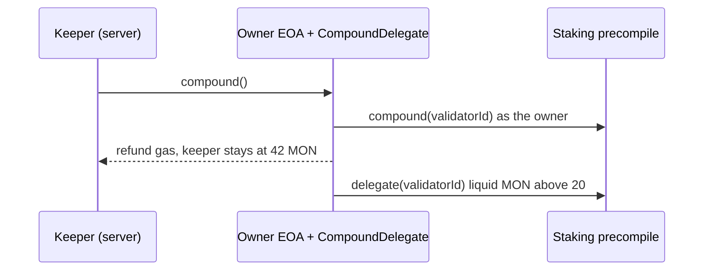

# monad-keeper

Auto-compound Monad staking rewards without putting the owner key on a server.

The owner account (e.g. a validator's auth address on a Ledger) signs a single
[EIP-7702](https://eips.ethereum.org/EIPS/eip-7702) authorization. From then on a separate hot
key — the keeper — can trigger `compound()` for that account, and nothing else.



- **Owner key stays offline.** The server holds only the keeper key and the owner's address.
- **Narrow permissions.** The keeper can compound rewards into the owner's own delegation and
  receive a capped gas refund. It can't move funds anywhere else.
- **Fees get staked too.** Liquid MON above `OWNER_BALANCE_MON` (e.g. priority fees, when the
  owner is the node's beneficiary) is delegated in the same call, always to the same validator.
- **Optimal timing.** A few hundred blocks before the boundary block, so rewards start earning
  in the very next epoch. How many epochs apart is picked from the measured rewards, stake yield
  and gas cost, so a validator owner compounds every couple of epochs and a small delegator less often.
- **Self-funding.** The owner refunds each compound's gas exactly, so the keeper balance stays put.
- **Revocable.** `revoke` removes the delegation without the keeper key and works with the stock
  Ledger app.

## Quick start

Requires [Bun](https://bun.sh) and [Foundry](https://getfoundry.sh).

```sh
bun install
cp .env.example .env    # RPC_URL, CHAIN_ID, OWNER_SECRET (testnet)
bun run keygen          # random keeper key, saved to .env
bun run authorize       # funds the keeper, deploys CompoundDelegate, delegates the owner
                        # or `bun run setup` if the owner balance is short of 42 MON
bun run status
bun run compound        # one compound right now
```

To run the keeper on a server, see [docs/server.md](docs/server.md).

## Commands

| Command | |
|---|---|
| `bun run keygen [--force]` | Generate a random keeper key into `.env` |
| `bun run status` | Delegation, balances, pending rewards |
| `bun run top` | Live dashboard: next compound, balances, stake, service log. Needs no keys |
| `bun run delegate-address` | CompoundDelegate address for the configured keeper |
| `bun run authorize [--ledger]` | Fund keeper, deploy delegate if needed, delegate the owner |
| `bun run setup [--ledger]` | Claim rewards, then `authorize`. The first compound stakes them back |
| `bun run revoke [--ledger]` | Remove the delegation, without the keeper key |
| `bun run compound` | Compound right now |
| `bun run start` | Keeper loop: compound every `COMPOUND_EVERY` epochs |
| `bun run build:linux-x64` | Standalone server binary (also `build:linux-arm64`) |
| `bun run test` | Contract tests |

## Docs

- [How it works](docs/how-it-works.md): delegation, timing, interval, gas refund, threat model
- [Configuration](docs/configuration.md): environment variables
- [Running on a server](docs/server.md): standalone binary and a sandboxed systemd service
- [Mainnet with Ledger](docs/ledger.md): signing the authorization when the owner is on a Ledger
